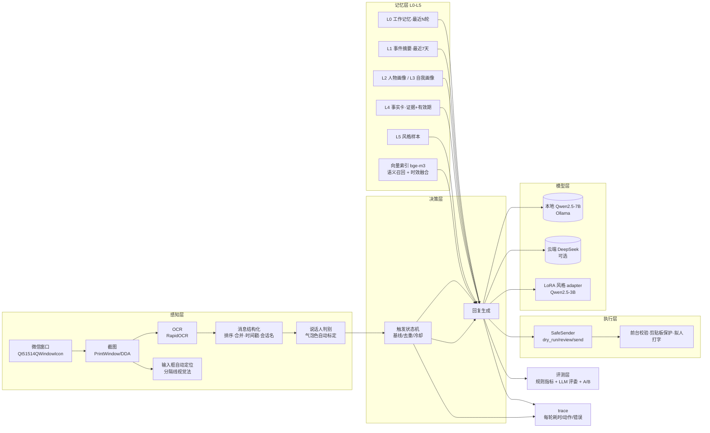

# wagent · 桌面微信 GUI Agent（带层级记忆）

> **不 hook、不注入、不解密、不碰微信进程内存**：用「截屏 + OCR」感知屏幕，用「键鼠模拟」回复，
> 用本地大模型 + 分层记忆让回复「记得住事、像本人」。

这是一个**桌面多模态个人代理**：它把微信窗口当成一个 GUI 环境去感知和操作，把聊天对象当成
有长期记忆的对话方。核心不是"调一次 LLM"，而是 **感知 → 决策（触发/意图）→ 记忆检索 →
生成 → 安全执行 → 评测** 的完整闭环。

> ⚠️ 仅供个人学习与本地自用；自动化操作微信违反其用户协议，存在账号风险；请勿用于骚扰、
> 诈骗、营销等场景。详见文末「安全与合规」。

---

## 架构



## 关键工程点（也是面试能讲的部分）

| 问题 | 做法 |
|---|---|
| 微信 4.x 换了 UI 框架，旧类名 `WeChatMainWndForPC` 失效 | 类名正则 + 进程名双重识别；主窗口最小化时自动还原 |
| 微信是 GPU 自绘窗口，GDI 截屏黑屏；窗口被遮挡时 DDA 截到别的程序 | `PrintWindow(PW_RENDERFULLCONTENT)` 截 Qt 窗口，实测与屏幕像素一致、遮挡也能截 |
| 气泡绿在 4.x 变成 RGB(157,242,159)，写死颜色必错 | **自动标定**：几何自举（左右留白）+ 颜色聚类（彩色=我、比背景亮=对方），按主题缓存 |
| OCR 按返回顺序拼、多行消息被拆开、时间戳被当成聊天内容 | 按 y 排序；用**气泡左右边界**判断"同一气泡"再合并；时间戳/系统提示/媒体占位过滤 |
| 输入框坐标写死，换窗口/DPI 就点空 | 三级定位（UIA → 输入框上方分隔线视觉法 → 比例兜底）+ 置信度；消息区下边界由输入框反推 |
| 每轮都跑两次 OCR，一秒一次会占满 CPU | 消息区帧签名缓存 + 几何信息 TTL，窗口不变直接复用解析结果 |
| 启动就回旧消息、重复内容永久失效、滚动误触发 | 显式状态机（BASELINE/IDLE/REPLYING/COOLDOWN）+ 尾部序列判断"追加 vs 滚动/抖动" |
| 只回 12 句，记不住上周的事 | L0-L5 分层记忆：工作记忆/事件摘要/画像/事实卡/风格样本，按"相关性+时效+置信度"检索并做字符预算 |
| 语义相关但很久以前的事想不起来 | 本地 bge-m3 向量索引 + `0.15×时间新鲜度 + 0.85×余弦相似度` 融合：问"工作"时 3 个月前的工作事件能排到第一 |
| LLM 抽记忆会编造 | 强制 `evidence_msg_id`，证据不在输入里直接丢弃；同 key 新值自动 supersede 旧值 |
| 聊天内容上传云端有隐私顾虑 | 默认本地 Ollama；云端 DeepSeek 作为可选通道；embedding/记忆全在本地 SQLite |
| 一开自动发送就把内容打进别的程序 | `dry_run/review/send` 三级；点击前后各校验一次前台窗口；剪贴板保存恢复；失败原因可解释 |
| 每条都回显得很傻 / 金钱话题危险 | 意图路由（规则 + 可选 LLM 兜底）：语气词/表情 `NO_REPLY`、金钱隐私 `SENSITIVE` 直接不回 |
| 模型可能说出不该说的话 | 输出护栏：金钱/验证码关键词拦截、手机号/身份证/邮箱/卡号脱敏、复述对方原话拦截、超长拦截 |
| 不知道模型变好没有 | 规则指标（风格相似度/AI 味/长度/复读）+ LLM 评委成对比较（交换位置抵消偏差）+ A/B 报告 |
| 不知道一轮卡在哪 | 轻量 trace：perceive/generate/send/tick 的毫秒与动作写 JSONL，`--trace` 一键开启 |

## 快速开始

```powershell
# 0) 环境（Windows + conda）
conda create -y -n wagent python=3.12
conda activate wagent
pip install -e ".[dev,windows]"

# 1) 离线演示：不碰微信、不联网、不发送
python -m wagent.main --mock --fake-llm

# 2) 接本地模型跑真实窗口（默认 dry-run：只打印不发送）
ollama pull qwen2.5:7b-instruct-q4_K_M
python -m wagent.main            # 截图 → OCR → 触发/意图 → 生成 → 护栏 → 预览

# 3) 人工确认后发送（意图路由与安全护栏默认开启；--no-intent/--no-guard 可关）
python -m wagent.main --mode review

# 4) 导入历史聊天（两种来源，任选）
python -m wagent.import_chat csv   --file chat.csv --person 张三
python -m wagent.import_chat scroll --person 张三 --max-frames 20

# 5) 记忆巩固（LLM 抽事实 + 摘要）并建向量索引（本地 bge-m3）
python scripts/consolidate.py --person 张三 --index

# 6) 导出训练集 → 训练 3B LoRA（8GB 显存 QLoRA）
python scripts/export_training_data.py --out data/train
python scripts/train_lora.py --base models/Qwen2.5-3B-Instruct --data data/train --out data/lora/style

# 7) A/B 评测（生成与盲评分两段跑，避开显存争用）
python scripts/eval_ab.py --adapter data/lora/style
python scripts/judge_replies.py

# 8) 带 trace 跑真机（每轮耗时落 data/trace/*.jsonl）
python -m wagent.main --trace
```

## 目录结构

```
src/wagent/
├── config.py          # pydantic-settings 配置（.env / WAGENT_ 前缀）
├── winapi.py          # DPI 感知、点击/滚动/剪贴板、前台窗口
├── perception/        # 感知层：窗口/截图/OCR/解析/说话人/区域/输入框/自动标定/帧缓存
├── im/                # IM 适配层：WeChatAdapter（真实窗口）+ MockAdapter（离线/CI）
├── agent/             # 触发状态机 + 意图路由 + 运行时（感知→决策→生成→护栏→发送）
├── llm/               # 双通道客户端（本地/云端）+ prompt 构建 + 出口清洗
├── guard/             # 输出护栏：金钱/隐私拦截、PII 脱敏、注入检测
├── actuator.py        # 安全执行：dry_run/review/send、拟人打字、前台校验
├── memory/            # L0-L5：SQLite 存储、分层检索、记忆巩固、向量索引(bge-m3)
├── importers/         # CSV/JSON(L) 导入、导出格式探测、滚动 OCR 采史、时间戳解析
├── train/             # 训练集构造、合成数据、QLoRA 训练、推理
├── eval/              # 规则指标 + LLM 评委 + A/B
├── observability/     # 轻量 trace（每轮耗时/动作/错误 → JSONL）
└── main.py            # CLI 主循环
scripts/               # 现场诊断、采史/巩固/训练/评测/盲评
docs/                  # RESUME.md（简历&面试材料）、DESIGN_DECISIONS.md（ADR）
tests/                 # 单测（200+，纯逻辑不依赖模型/Windows GUI）
```

## 质量与指标

```powershell
pytest -q          # ~190 个单测（纯逻辑，不依赖模型/Windows GUI）
ruff check src tests scripts
mypy               # 按 Windows 平台类型检查
```

**3B QLoRA 实测**（RTX 5060 Laptop 8GB，Qwen2.5-3B-Instruct，4bit，r=16，
228 条**合成**样本，1 epoch，5.6 分钟，train_loss 3.84 → 0.76）：

| 指标 | base | LoRA | 说明 |
|---|---|---|---|
| 综合分 | 0.455 | **0.510** | 风格 50% + 自然度 25% + 反 AI 味 25% |
| 风格相似度 | 0.014 | 0.020 | 与「我真实说过的话」的字级 2-gram 重叠 |
| AI 味 | 0.21 | **0.00** | 模板连接词/说教腔/您/亲 等 |
| 长度自然度 | 1.00 | 1.00 | 都在 3~30 字区间 |
| LLM 评委胜率 | — | **55.6%** | 本地 7B 盲评 10 例：base 4 / LoRA 5 / 平 1 |

> ⚠️ 上表是**合成数据**上跑通链路的结果，证明「数据→训练→推理→A/B」全流程可用；
> 真实风格效果需要导入真实聊天记录后重训。运行方式：
> `python scripts/train_lora.py --data data/train` + `python scripts/eval_ab.py` + `python scripts/judge_replies.py`。

**消融实验：有 / 无层级记忆**（同一本地 7B、12 条样本、记忆命中率 100%）：

| 组 | 综合分 | 风格相似 | AI 味 |
|---|---|---|---|
| 无记忆 | 0.587 | 0.189 | 0.025 |
| 有记忆 | **0.625** | **0.251** | **0.00** |

LLM 盲评 5 : 3 : 4（无记忆胜/有记忆胜/平）——样本小且合成 prompt 与预置记忆不匹配，
**诚实结论：记忆的收益需要用真实聊天数据验证**，这也是评测体系存在的意义。
完整记录见 [docs/DEMO.md](./docs/DEMO.md)。

| 能力 | 说明 |
|---|---|
| 触发准确率 / 误触发 | 状态机场景用例覆盖基线、滚动、抖动、重复内容、会话切换 |
| 说话人判别 | 自动标定 + 加权投票，无法判定返回 UNKNOWN（不触发） |
| 记忆事实 | 每条带证据消息 id 与原文，可溯源；同 key 冲突自动 supersede |
| 语义召回 | 本地 bge-m3 + 时间新鲜度融合，旧事件也能被正确想起 |
| 执行安全 | dry_run 不碰键鼠；发送前校验前台窗口；剪贴板保存恢复 |
| 可观测 | 每轮 perceive/generate/send 耗时写 `data/trace/*.jsonl` |

**实测性能**（真机 1300×1366 窗口，RTX 5060 + Ultra 5）：

| 场景 | 耗时 |
|---|---|
| 冷启动首轮（标题+消息区两次 OCR + 气泡配色学习） | ≈ 12s |
| 稳态轮询（帧缓存命中，画面未变） | **≈ 40ms** |
| 本地 7B 生成一句回复 | ≈ 0.66s |

> 已知限制：冷启动 OCR 是主要延迟来源，优化方向是异步 OCR/只 OCR 消息区底部/量化小模型，
> 见 [ROADMAP.md](./ROADMAP.md) P0-5。

## 安全与合规

- 本项目只做**屏幕读取 + 键鼠模拟**，不读取微信数据库、不注入、不修改微信进程；
- 自动化操作微信**违反微信用户协议**，存在封号风险，请自行评估；
- 聊天数据只存本地 SQLite；默认使用本地模型，云端通道需显式配置；
- 默认 `dry_run`（只预览不发送）；`review` 需逐条确认；`send` 全自动，风险自负；
- 不处理转账/红包/收款等金钱场景；请勿用于骚扰、诈骗、营销等用途。

## 路线图

见 [ROADMAP.md](./ROADMAP.md)。已完成：感知层重构、输入框自动定位、安全执行、触发状态机、
本地/云端双通道、L0-L5 记忆库、离线导入、记忆巩固、向量检索、训练集管线、LoRA 训练与 A/B 评测、
trace 可观测。

> 简历/面试材料见 [docs/RESUME.md](./docs/RESUME.md)；关键取舍见
> [docs/DESIGN_DECISIONS.md](./docs/DESIGN_DECISIONS.md)；真实聊天记录采集与导入见
> [docs/DATA_EXPORT.md](./docs/DATA_EXPORT.md)。

## License

[MIT](./LICENSE)。原始需求与技术方案见 [微信自动回复技术实现方案.md](./微信自动回复技术实现方案.md)。
