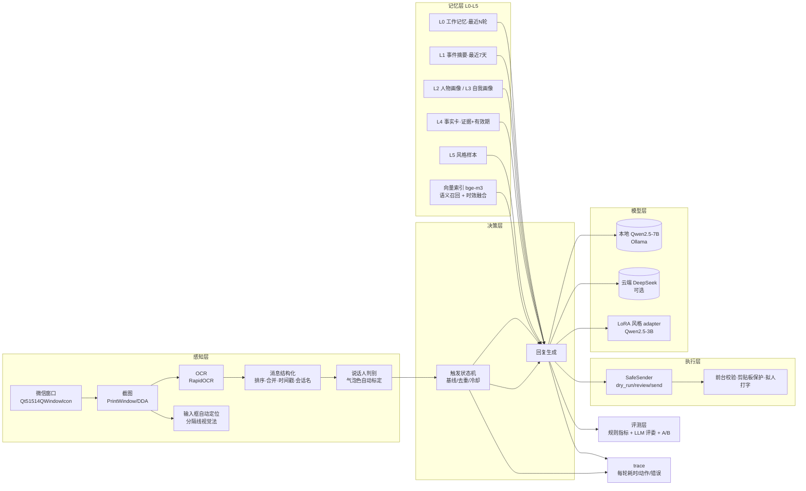

# wagent · 桌面微信 GUI Agent（带层级记忆）

> **不 hook、不注入、不解密、不碰微信进程内存**：用「截屏 + OCR」感知屏幕，用「键鼠模拟」回复，
> 用本地大模型 + 分层记忆让回复「记得住事、像本人」。

这是一个**桌面多模态个人代理**：它把微信窗口当成一个 GUI 环境去感知和操作，把聊天对象当成
有长期记忆的对话方。核心不是"调一次 LLM"，而是 **感知 → 决策（触发/意图）→ 记忆检索 →
生成 → 安全执行 → 评测** 的完整闭环。

> ⚠️ 仅供个人学习与本地自用；自动化操作微信违反其用户协议，存在账号风险；请勿用于骚扰、
> 诈骗、营销等场景。详见文末「安全与合规」。

---

## 架构



## 关键工程点（也是面试能讲的部分）

| 问题 | 做法 |
|---|---|
| 微信 4.x 换了 UI 框架，旧类名 `WeChatMainWndForPC` 失效 | 类名正则 + 进程名双重识别；主窗口最小化时自动还原 |
| 微信是 GPU 自绘窗口，GDI 截屏黑屏；窗口被遮挡时 DDA 截到别的程序 | `PrintWindow(PW_RENDERFULLCONTENT)` 截 Qt 窗口，实测与屏幕像素一致、遮挡也能截 |
| 气泡绿在 4.x 变成 RGB(157,242,159)，写死颜色必错 | **自动标定**：几何自举（左右留白）+ 颜色聚类（彩色=我、比背景亮=对方），按主题缓存 |
| OCR 按返回顺序拼、多行消息被拆开、时间戳被当成聊天内容 | 按 y 排序；用**气泡左右边界**判断"同一气泡"再合并；时间戳/系统提示/媒体占位过滤 |
| 输入框坐标写死，换窗口/DPI 就点空 | 三级定位（UIA → 输入框上方分隔线视觉法 → 比例兜底）+ 置信度；消息区下边界由输入框反推 |
| 每轮都跑两次 OCR，一秒一次会占满 CPU | 消息区帧签名缓存 + 几何信息 TTL，窗口不变直接复用解析结果 |
| 启动就回旧消息、重复内容永久失效、滚动误触发 | 显式状态机（BASELINE/IDLE/REPLYING/COOLDOWN）+ 尾部序列判断"追加 vs 滚动/抖动" |
| 只回 12 句，记不住上周的事 | L0-L5 分层记忆：工作记忆/事件摘要/画像/事实卡/风格样本，按"相关性+时效+置信度"检索并做字符预算 |
| 语义相关但很久以前的事想不起来 | 本地 bge-m3 向量索引 + `0.15×时间新鲜度 + 0.85×余弦相似度` 融合：问"工作"时 3 个月前的工作事件能排到第一 |
| LLM 抽记忆会编造 | 强制 `evidence_msg_id`，证据不在输入里直接丢弃；同 key 新值自动 supersede 旧值 |
| 聊天内容上传云端有隐私顾虑 | 默认本地 Ollama；云端 DeepSeek 作为可选通道；embedding/记忆全在本地 SQLite |
| 一开自动发送就把内容打进别的程序 | `dry_run/review/send` 三级；点击前后各校验一次前台窗口；剪贴板保存恢复；失败原因可解释 |
| 每条都回显得很傻 / 金钱话题危险 | 意图路由（规则 + 可选 LLM 兜底）：语气词/表情 `NO_REPLY`、金钱隐私 `SENSITIVE` 直接不回 |
| 模型可能说出不该说的话 | 输出护栏：金钱/验证码关键词拦截、手机号/身份证/邮箱/卡号脱敏、复述对方原话拦截、超长拦截 |
| 不知道模型变好没有 | 规则指标（风格相似度/AI 味/长度/复读）+ LLM 评委成对比较（交换位置抵消偏差）+ A/B 报告 |
| 不知道一轮卡在哪 | 轻量 trace：perceive/generate/send/tick 的毫秒与动作写 JSONL，`--trace` 一键开启 |

## 快速开始

```powershell
# 0) 环境（Windows + conda）
conda create -y -n wagent python=3.12
conda activate wagent
pip install -e ".[dev,windows]"

# 1) 离线演示：不碰微信、不联网、不发送
python -m wagent.main --mock --fake-llm

# 2) 接本地模型跑真实窗口（默认 dry-run：只打印不发送）
ollama pull qwen2.5:7b-instruct-q4_K_M
python -m wagent.main            # 截图 → OCR → 触发/意图 → 生成 → 护栏 → 预览

# 3) 人工确认后发送（意图路由与安全护栏默认开启；--no-intent/--no-guard 可关）
python -m wagent.main --mode review

# 4) 导入历史聊天（两种来源，任选）
python -m wagent.import_chat csv   --file chat.csv --person 张三
python -m wagent.import_chat scroll --person 张三 --max-frames 20

# 5) 记忆巩固（LLM 抽事实 + 摘要）并建向量索引（本地 bge-m3）
python scripts/consolidate.py --person 张三 --index

# 6) 导出训练集 → 训练 3B LoRA（8GB 显存 QLoRA）
python scripts/export_training_data.py --out data/train
python scripts/train_lora.py --base models/Qwen2.5-3B-Instruct --data data/train --out data/lora/style

# 7) A/B 评测（生成与盲评分两段跑，避开显存争用）
python scripts/eval_ab.py --adapter data/lora/style
python scripts/judge_replies.py

# 8) 带 trace 跑真机（每轮耗时落 data/trace/*.jsonl）
python -m wagent.main --trace
```

## 目录结构

```
src/wagent/
├── config.py          # pydantic-settings 配置（.env / WAGENT_ 前缀）
├── winapi.py          # DPI 感知、点击/滚动/剪贴板、前台窗口
├── perception/        # 感知层：窗口/截图/OCR/解析/说话人/区域/输入框/自动标定/帧缓存
├── im/                # IM 适配层：WeChatAdapter（真实窗口）+ MockAdapter（离线/CI）
├── agent/             # 触发状态机 + 意图路由 + 运行时（感知→决策→生成→护栏→发送）
├── llm/               # 双通道客户端（本地/云端）+ prompt 构建 + 出口清洗
├── guard/             # 输出护栏：金钱/隐私拦截、PII 脱敏、注入检测
├── actuator.py        # 安全执行：dry_run/review/send、拟人打字、前台校验
├── memory/            # L0-L5：SQLite 存储、分层检索、记忆巩固、向量索引(bge-m3)
├── importers/         # CSV/JSON(L) 导入、导出格式探测、滚动 OCR 采史、时间戳解析
├── train/             # 训练集构造、合成数据、QLoRA 训练、推理
├── eval/              # 规则指标 + LLM 评委 + A/B
├── observability/     # 轻量 trace（每轮耗时/动作/错误 → JSONL）
└── main.py            # CLI 主循环
scripts/               # 现场诊断、采史/巩固/训练/评测/盲评
docs/                  # RESUME.md（简历&面试材料）、DESIGN_DECISIONS.md（ADR）
tests/                 # 单测（200+，纯逻辑不依赖模型/Windows GUI）
```

## 质量与指标

```powershell
pytest -q          # ~190 个单测（纯逻辑，不依赖模型/Windows GUI）
ruff check src tests scripts
mypy               # 按 Windows 平台类型检查
```

**真实数据实测**（与吴浩毅的 1v1 聊天：**28,869 条文本消息 / 3 年**（2023-08 → 2026-11），
其中我的回复 11,497 条；平均 8.3 字、中位数 5 字、句号率 0.1%、emoji 率 0.7%）：

| 阶段 | 配置 | 结果 |
|---|---|---|
| 数据导入 | Moect JSONL → `import_chat json` | 34,841 行 → 28,869 条（媒体跳过 5,735） |
| 记忆巩固 | 本地 7B 抽事实 + bge-m3 索引 | **77 条事实卡（带证据）+ 4 条事件摘要 + 300 条风格样本 + 332 条向量** |
| LoRA 训练 | Qwen2.5-3B 4bit QLoRA，800 条真实 Q/A，r=16，seq 384 | 100 步 / **10.5 分钟** / train_loss 1.61 |
| A/B 规则指标 | base vs 真实 LoRA，15 条真实 val | 综合分 **0.468 → 0.505**，AI 味 **0.22 → 0.00** |
| A/B 盲评 | 本地 7B 成对比较（交换位置） | base 1 / **LoRA 10** / 平 4 → **LoRA 胜率 90.9%** |

盲评样例（base 长句 + AI 味，LoRA 是本人那种极短回复）：

```
对方: （分享近况）
base : 哈哈，都是因为你！下午见，得赶紧去准备一下，不然都来不及了。 → 被判负
LoRA : 嗯                                                         → 被判胜
base : 好的，我知道了。                                            → 被判负
LoRA : 嗯嗯                                                       → 被判胜
base : 那我直接去考场了，考试结束后咱们再复习吧。                   → 被判负
LoRA : [强]                                                       → 被判胜
```

> 说明：规则指标里的「风格相似度」对 5 字以内的短回复不敏感（2-gram 重叠天然吃亏），
> 所以同一批样本上 LoRA 的 style 分数反而低于 base；**LLM 盲评更接近真实体感**，
> 这也是项目同时保留两套指标的原因。评测数据与报告都在本地 `data/eval/`（不入库）。

**消融实验：有 / 无层级记忆**（真实库 + 同一本地 7B、12 条真实样本）：

| 组 | 综合分 | 风格相似 | AI 味 |
|---|---|---|---|
| 无记忆 | 0.529 | 0.058 | 0.00 |
| 有记忆 | 0.533 | 0.069 | 0.00 |

LLM 盲评 5 : 2 : 5（无记忆胜/有记忆胜/平）——规则指标略升、盲评无显著差异。
**诚实结论：在「短句闲聊」场景，记忆注入的收益不明显；它的价值主要在"记得住事实/约定"，
需要用回忆类问题单独评测**（后续工作）。合成数据上的首轮消融为 0.587→0.625（5:3:4），
同样不能夸大。完整记录见 [docs/DEMO.md](./docs/DEMO.md)。

**记忆召回评测**（28 条真实事实卡 → 生成回忆式问题 → 走完整检索链，不需要生成模型）：

| 指标 | 结果 |
|---|---|
| recall@1 | **0.96** |
| recall@3 | **1.00** |
| MRR | **0.98** |

> 这轮评测抓到一个真 bug：**「我」的事实存在 `__self__` 分区，而检索只查了对方分区**，
> 导致"我"说过的事永远记不起来（recall@1 仅 0.61）；修复后 0.61 → 0.96。
> 复现：`python scripts/recall_eval.py --person <联系人> --limit 30`。

| 能力 | 说明 |
|---|---|
| 触发准确率 / 误触发 | 状态机场景用例覆盖基线、滚动、抖动、重复内容、会话切换 |
| 说话人判别 | 自动标定 + 加权投票，无法判定返回 UNKNOWN（不触发） |
| 记忆事实 | 每条带证据消息 id 与原文，可溯源；同 key 冲突自动 supersede |
| 语义召回 | 本地 bge-m3 + 时间新鲜度融合，旧事件也能被正确想起 |
| 执行安全 | dry_run 不碰键鼠；发送前校验前台窗口；剪贴板保存恢复 |
| 可观测 | 每轮 perceive/generate/send 耗时写 `data/trace/*.jsonl` |

**实测性能**（真机 1300×1366 窗口，RTX 5060 + Ultra 5）：

| 场景 | 耗时 |
|---|---|
| 冷启动首轮（标题+消息区两次 OCR + 气泡配色学习） | ≈ 12s |
| 稳态轮询（帧缓存命中，画面未变） | **≈ 40ms** |
| 本地 7B 生成一句回复 | ≈ 0.66s |

> 已知限制：冷启动 OCR 是主要延迟来源，优化方向是异步 OCR/只 OCR 消息区底部/量化小模型，
> 见 [ROADMAP.md](./ROADMAP.md) P0-5。

## 安全与合规

- 本项目只做**屏幕读取 + 键鼠模拟**，不读取微信数据库、不注入、不修改微信进程；
- 自动化操作微信**违反微信用户协议**，存在封号风险，请自行评估；
- 聊天数据只存本地 SQLite；默认使用本地模型，云端通道需显式配置；
- 默认 `dry_run`（只预览不发送）；`review` 需逐条确认；`send` 全自动，风险自负；
- 不处理转账/红包/收款等金钱场景；请勿用于骚扰、诈骗、营销等用途。

## 路线图

见 [ROADMAP.md](./ROADMAP.md)。已完成：感知层重构、输入框自动定位、安全执行、触发状态机、
本地/云端双通道、L0-L5 记忆库、离线导入、记忆巩固、向量检索、训练集管线、LoRA 训练与 A/B 评测、
trace 可观测。

> 简历/面试材料见 [docs/RESUME.md](./docs/RESUME.md)；关键取舍见
> [docs/DESIGN_DECISIONS.md](./docs/DESIGN_DECISIONS.md)；真实聊天记录采集与导入见
> [docs/DATA_EXPORT.md](./docs/DATA_EXPORT.md)。

## License

[MIT](./LICENSE)。原始需求与技术方案见 [微信自动回复技术实现方案.md](./微信自动回复技术实现方案.md)。
